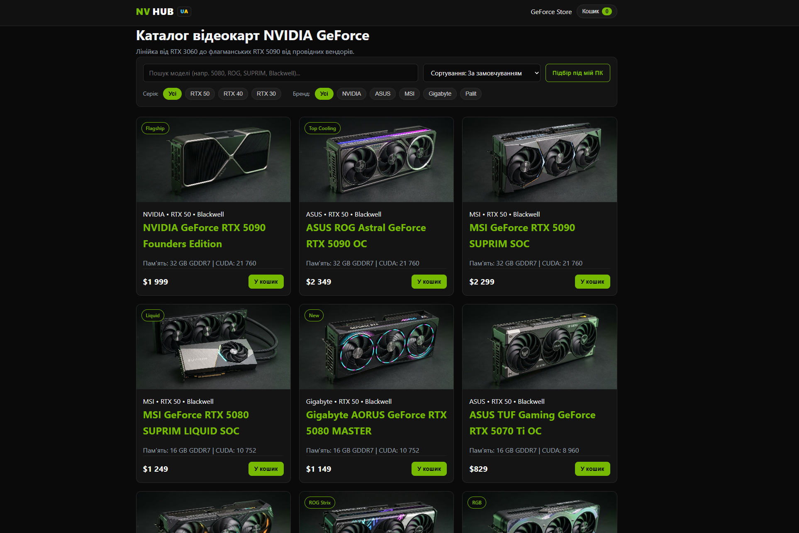

# NV HUB — каталог відеокарт NVIDIA GeForce

NV HUB — україномовний вебзастосунок-каталог відеокарт NVIDIA GeForce. Інтерфейс оформлений у темній темі з акцентами в стилі NVIDIA та містить актуальні моделі серій RTX 3000, RTX 4000 і RTX 5000.

## Основний функціонал

- **Каталог товарів:** 24 моделі від NVIDIA, ASUS, MSI, Gigabyte і Palit динамічно завантажуються з `public/data/gpus.json`.
- **Пошук і фільтри:** пошук за назвою, брендом або архітектурою, фільтрація за серією та брендом, сортування за ціною.
- **Підбір під мій ПК:** конфігуратор фільтрує моделі за рівнем процесора (CPU), потужністю блока живлення (БЖ), максимальною довжиною відеокарти та цільовою роздільною здатністю.
- **Деталі відеокарти:** модальне вікно показує опис, VRAM, кількість CUDA-ядер, TDP, рекомендовані БЖ і CPU, роз'єм живлення та габарити. Поки відкрите будь-яке модальне вікно, прокручування фону заблоковане.
- **Кошик і оформлення:** стан кошика зберігається в `localStorage`; доступні зміна кількості товару, видалення позицій і швидке очищення кошика. Форма замовлення перевіряє обов'язкові поля та формат номера телефону.
- **Адаптивний інтерфейс:** каталог і модальні вікна пристосовуються до екранів комп'ютерів, планшетів і смартфонів.



## Технологічний стек

Версії наведені відповідно до діапазонів, зазначених у `package.json`:

- Vue `^3.5.42` — Composition API та реактивний інтерфейс.
- Vite `^8.2.2` — локальний сервер розробки та production-збірка.
- `@vitejs/plugin-vue` `^6.0.8` — інтеграція Vue з Vite.
- Чистий CSS — стилі без CSS-фреймворків.
- JavaScript з ES-модулями.

Для запуску використовуйте Node.js, що відповідає вимозі проєкту: `^22.18.0` або `>=24.12.0`.

## Структура проєкту

```text
.
├── public/
│   ├── data/
│   │   └── gpus.json          # Дані каталогу
│   ├── img/                   # Зображення відеокарт
│   └── favicon.ico
├── src/
│   ├── assets/
│   │   └── style.css          # Стилі застосунку
│   ├── components/
│   │   ├── AppHeader.vue      # Шапка та кнопка кошика
│   │   ├── CartItem.vue       # Товар у кошику
│   │   └── ProductCard.vue    # Картка відеокарти
│   ├── App.vue                # Основна логіка, каталог і модальні вікна
│   └── main.js                # Точка входу Vue
├── index.html
├── package.json
├── vite.config.js
└── README.md
```

## Встановлення та запуск

Виконайте команди з кореня проєкту:

```bash
npm install
npm run dev
```

Відкрийте адресу, яку покаже Vite у терміналі (зазвичай `http://localhost:5173`).

Щоб створити production-збірку:

```bash
npm run build
```

За потреби переглянути зібрану версію локально:

```bash
npm run preview
```
